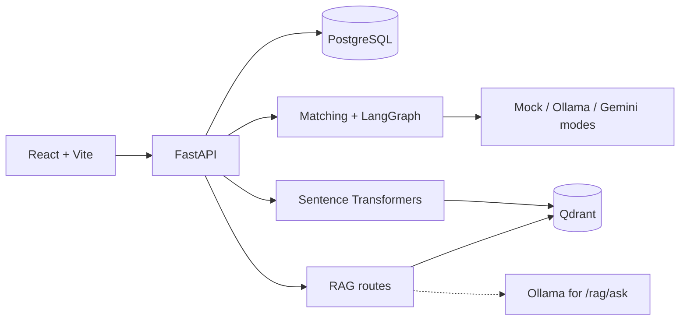
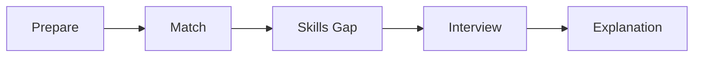

# SkillMatch AI

**AI-powered recruitment matching, career guidance, and experimental agentic/RAG workflows**

SkillMatch AI is a full-stack project for comparing candidate profiles and CVs with job offers. It combines structured skills matching with LLM-assisted analysis, skill-gap recommendations, interview preparation, and semantic retrieval over indexed documents.

The project uses a **React/Vite frontend**, **FastAPI backend**, **PostgreSQL**, **Docker Compose**, and optional **local/remote LLM services**. Its repository includes working-code paths for **LangGraph** orchestration and **Qdrant** vector retrieval; these are implemented features, not just items on a roadmap. Deployment and integration quality are still development-stage.

## Main capabilities

| Area | Repository implementation |
| --- | --- |
| User access | JWT authentication and candidate, recruiter, admin roles |
| Candidate profiles | PDF upload, text extraction, skill detection, profile management |
| Job offers | Create offers, analyze descriptions, import information from public pages with a manual fallback |
| Matching | Candidate-to-job compatibility scoring, matched/missing skills, job ranking |
| Career assistance | Skill-gap analysis, roadmaps, interview-question generation and answer evaluation endpoints |
| Agentic workflow | LangGraph orchestration with prepare, matching, skills-gap, interview, and explanation nodes |
| Semantic retrieval | sentence-transformers embeddings, Qdrant indexing/search, and experimental RAG endpoints |

## Architecture



> This diagram shows implementation modules, not a claim that every route works without an external model. In particular, `/rag/ask` calls Ollama directly.

## Backend modules

- `backend/app/routes/candidates.py`: candidate creation, CV uploads, and optional Qdrant indexing.
- `backend/app/routes/jobs.py`, `matching.py`: job persistence, matching and ranking.
- `backend/app/routes/skills_gap.py`, `interview.py`: career guidance and interview workflows.
- `backend/app/routes/agentic.py`: orchestrator and LangGraph endpoints.
- `backend/app/agents/langgraph_orchestrator.py`: agent state and graph nodes.
- `backend/app/services/embedding_service.py`: sentence-transformers embeddings.
- `backend/app/services/vector_store.py`: Qdrant vector collection and semantic search.
- `backend/app/routes/rag.py`: `/rag/index`, `/rag/search`, and `/rag/ask`.

### LangGraph workflow



The graph combines structured matching with LLM-generated interview preparation and explanations. Some LLM-dependent outputs may be mock values or require an external provider; they are not substitutes for human recruiting decisions.

### Qdrant and RAG

The backend can create text embeddings and index documents in Qdrant. It exposes endpoints for semantic retrieval and generating context-grounded responses.

- **Embedding model:** configurable sentence-transformers model; default declared in `embedding_service.py`.
- **Vector store:** Qdrant, configured as a Docker Compose service with persistent storage.
- **Retrieval:** cosine-similarity search with optional document-type filtering.
- **RAG response:** searches indexed context, then asks an LLM to answer using that context.

Qdrant indexing is best-effort in some candidate flows; failures are logged rather than blocking profile creation. These retrieval features require a running Qdrant instance, a compatible embedding model, and (for `/rag/ask`) an accessible Ollama instance.

## Run locally

**Prerequisites:** Docker Desktop or Docker Engine + Compose, adequate memory for the embedding model, and optionally an LLM runtime such as Ollama.

```bash
git clone https://github.com/Nadaaath/skillmatch-ai.git
cd skillmatch-ai
```

**Windows PowerShell:**

```powershell
Copy-Item .env.example .env
docker compose up --build -d
docker compose ps
```

**macOS/Linux:**

```bash
cp .env.example .env
docker compose up --build -d
docker compose ps
```

- **Frontend:** http://localhost:5173
- **FastAPI docs:** http://localhost:8000/docs
- **Qdrant:** http://localhost:6333

Set unique secrets in `.env` before sharing a deployment; `.env.example` contains development placeholders. Do **not** run `docker compose down -v` unless you intend to delete PostgreSQL and Qdrant volumes.

### LLM configuration

Use `LLM_PROVIDER=mock` for routes that support mock mode; this is the default in `.env.example` and lets you explore the application without a paid API key.

`backend/app/services/llm_service.py` contains provider paths for **mock**, **Ollama**, and **Gemini**. Other modules, such as `ai_extractor.py`, have different supported provider options; the modes are **not uniformly implemented across every endpoint**. For example, `/rag/ask` currently uses Ollama rather than the shared provider abstraction.

Use `LLM_PROVIDER=ollama` with a working `OLLAMA_BASE_URL` and downloaded model for local generation. A separate Gemini provider path is present in the LLM service and requires its own credentials. The `.env.example` also lists OpenAI-related variables, but that does not by itself establish complete OpenAI-provider support across the current code.

## Example demonstration

1. Register as a candidate and upload a **sample** PDF CV.
2. Create or import a sample job, or paste a job description manually.
3. Inspect match score, matched/missing skills, and recommendations.
4. Use the agentic route to generate a skill-gap and interview-preparation summary.
5. Test `/rag/index` and `/rag/search` with non-sensitive sample documents, with Qdrant running.
6. If Ollama is configured, try `/rag/ask` for a context-based response.
7. Switch to a recruiter role to explore ranking workflows.

## Security and limitations

- This is a **portfolio/development project**, not a production recruitment product.
- Uploaded CVs and indexed candidate data can be sensitive; use sample data and do not expose local services publicly without securing them.
- Matching and LLM outputs are decision-support tools, not hiring decisions.
- Web-page extraction uses a manual-input fallback when sites are inaccessible or protected.
- RAG/LangGraph modules are included in source code, but this README does not claim that all external integrations have undergone end-to-end CI validation.

## Future improvements

- Standardize LLM-provider configuration across all endpoints.
- Add comprehensive automated tests for agentic and RAG workflows.
- Improve failure reporting and idempotent indexing in Qdrant.
- Harden data privacy, retention, and role-based access for deployment.
